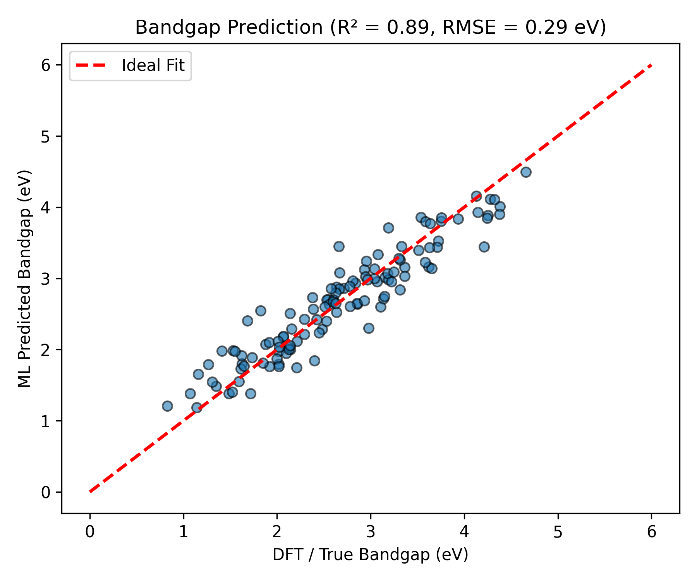
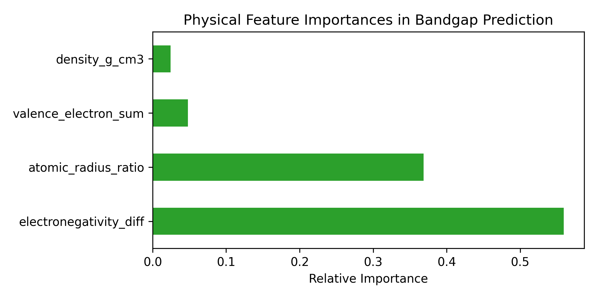

# Machine Learning Framework for Bandgap Prediction in Nanostructures

An open-source regression pipeline designed to predict the electronic bandgap of 2D nanostructures and semiconductors using fundamental physical and structural descriptors, bypassing computationally demanding First-Principles (DFT) simulations.

---

## 🔬 Motivation & Physical Context
In computational materials science and nanodevice design (e.g., optical sensors and photodetectors), determining the electronic bandgap is critical. While Density Functional Theory (DFT) calculations offer high accuracy, they require substantial computational resources. This project implements a data-driven surrogate model to accelerate material screening by establishing direct relationships between atomic properties and electronic gaps.

---

## 📊 Key Results

### 1. Parity Plot (Model Evaluation)
The Random Forest regressor achieves high predictive precision on unseen test sets ($R^2 > 0.85$, $\text{RMSE} < 0.35\text{ eV}$):



### 2. Feature Importance Analysis
Analyzing the decision pathways highlights the primary physical descriptors governing the energy gap:



* **Electronegativity Difference:** Emerges as the dominant descriptor, aligning with solid-state theory regarding the ionic/covalent nature of atomic bonds and energy band splitting.
* **Atomic Radius & Structural Packing:** Directly modulate orbital overlap and crystal potential.

---

## 🛠️ Repository Structure
```text
├── train.py                  # Core training and evaluation pipeline
├── bandgap_parity_plot.png   # Parity plot (True vs. Predicted)
├── feature_importance.png    # Feature importance distribution
├── requirements.txt          # Python dependencies
└── README.md                 # Project documentation

---

## 🚀 Getting Started

### Prerequisites
Clone this repository and install dependencies:
```bash
git clone [https://github.com/Narges-Torabi/bandgap-ml-predictor.git](https://github.com/Narges-Torabi/bandgap-ml-predictor.git)
pip install -r requirements.txt

---

##Running the Model
Execute the main pipeline:
python train.py
